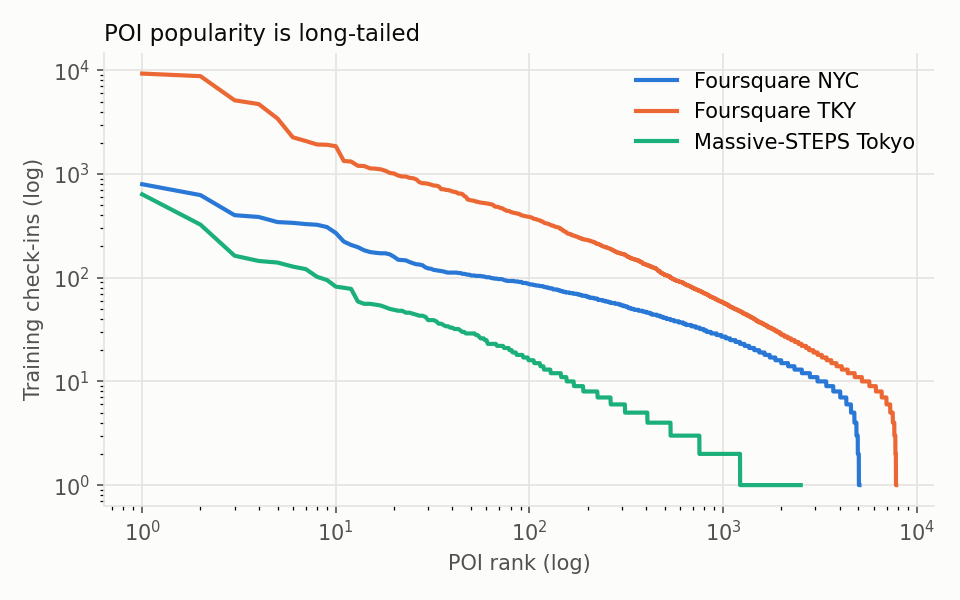
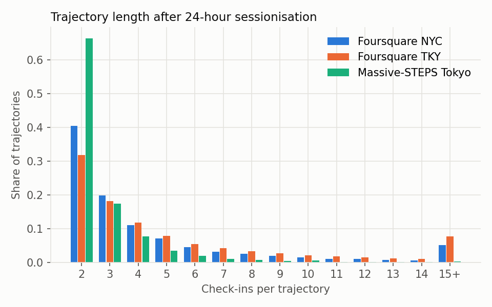
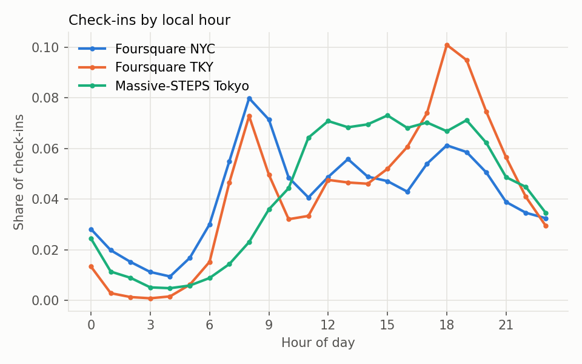
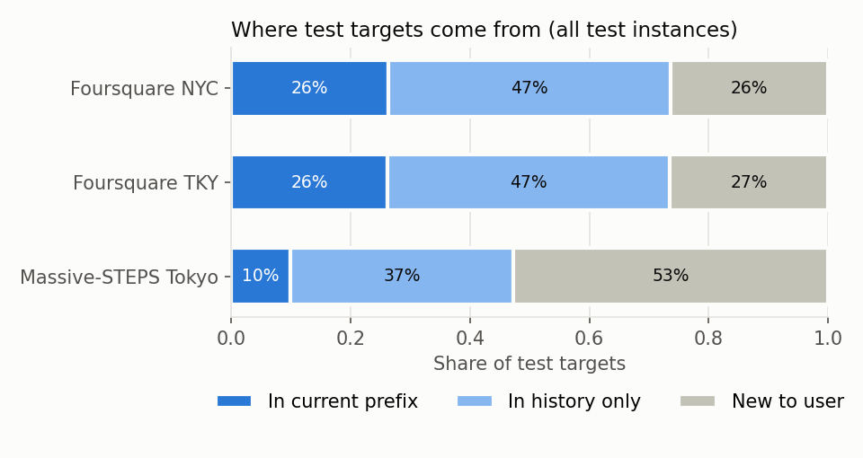

# TraceX data report (Member 1: data engineering & preprocessing)

Generated by `python -m tracex_data report` from the pipeline outputs; do not edit by hand.

## Protocol

- Session rule: a new trajectory starts at a gap of **>= 24 h** (and never spans two users or two splits).
- Split: chronological on the global timeline, 80/10/10 train/val/test by check-in time.
- Val/test keep only users and POIs seen in training; trajectories need >= 2 check-ins.
- Task: predict the **last check-in** of each val/test trajectory from its prefix and the user's history.
- History (fixed definition, used for E2): the user's trajectories in **train** that end before the target trajectory starts. `is_revisit` = target POI appears in history **or** in the current prefix.
- Evaluation sample: 500 test instances per dataset, seed 42; debug subset of 20.

## Dataset summary

|  | Foursquare NYC | Foursquare TKY | Massive-STEPS Tokyo |
|---|---|---|---|
| Raw rows | 227,428 | 573,703 | 13,839 |
| Users | 1,073 | 2,281 | 719 |
| POIs | 5,061 | 7,829 | 2,517 |
| Categories | 208 | 188 | 275 |
| Check-ins | 122,783 | 402,316 | 12,184 |
| Trajectories | 23,649 | 65,604 | 4,416 |
| Period | 2012-04-03 to 2013-02-15 | 2012-04-04 to 2013-02-16 | 2017-10-03 to 2018-10-20 |
| Check-ins / user (median) | 67.0 | 110.0 | 10.0 |
| Trajectories / user (median) | 19.0 | 25.0 | 4.0 |
| Trajectory length (mean / median) | 5.19 / 3.0 | 6.13 / 4.0 | 2.76 / 2.0 |
| Filters (min POI / user check-ins) | 10 / 10 | 10 / 10 | 1 / 5 |
| Published reference (users / POIs) | 1,048 / 4,981 | 2,282 / 7,833 | n/a |

## Splits

| Dataset | Split | Check-ins | Trajectories | Users | POIs | Split boundary |
|---|---|---|---|---|---|---|
| Foursquare NYC | train | 101,593 | 18,778 | 1073 | 5061 | < 2012-11-23 07:08:47 |
| Foursquare NYC | val | 10,795 | 2,485 | 664 | 2758 | < 2013-01-01 07:32:38 |
| Foursquare NYC | test | 10,395 | 2,386 | 604 | 2550 | rest |
| Foursquare TKY | train | 325,769 | 51,583 | 2281 | 7829 | < 2012-12-10 22:34:20 |
| Foursquare TKY | val | 38,467 | 7,045 | 1747 | 5390 | < 2013-01-12 18:58:55 |
| Foursquare TKY | test | 38,080 | 6,976 | 1659 | 5149 | rest |
| Massive-STEPS Tokyo | train | 10,448 | 3,715 | 719 | 2517 | < 2018-05-29 17:57:00 |
| Massive-STEPS Tokyo | val | 887 | 367 | 183 | 394 | < 2018-07-23 14:33:00 |
| Massive-STEPS Tokyo | test | 849 | 334 | 182 | 357 | rest |

## Cleaning and filtering log

**Foursquare NYC**

| Step | Rows before | Rows after | Removed |
|---|---|---|---|
| drop_missing_required_fields | 227,428 | 227,428 | 0 |
| drop_invalid_or_missing_coordinates | 227,428 | 227,428 | 0 |
| drop_duplicate_checkins(user,venue,time) | 227,428 | 227,178 | 250 |
| drop_pois_with_<10_checkins | 227,178 | 147,729 | 79,449 |
| drop_users_with_<10_checkins | 147,729 | 147,729 | 0 |
| assign_chronological_split | 147,729 | 147,729 | 0 |
| drop_train_trajectories_shorter_than_2 | 147,729 | 131,139 | 16,590 |
| drop_eval_checkins_with_user_or_poi_unseen_in_train | 131,139 | 129,449 | 1,690 |
| drop_eval_trajectories_shorter_than_2 | 129,449 | 122,783 | 6,666 |

**Foursquare TKY**

| Step | Rows before | Rows after | Removed |
|---|---|---|---|
| drop_missing_required_fields | 573,703 | 573,703 | 0 |
| drop_invalid_or_missing_coordinates | 573,703 | 573,703 | 0 |
| drop_duplicate_checkins(user,venue,time) | 573,703 | 573,126 | 577 |
| drop_pois_with_<10_checkins | 573,126 | 447,076 | 126,050 |
| drop_users_with_<10_checkins | 447,076 | 447,076 | 0 |
| assign_chronological_split | 447,076 | 447,076 | 0 |
| drop_train_trajectories_shorter_than_2 | 447,076 | 415,185 | 31,891 |
| drop_eval_checkins_with_user_or_poi_unseen_in_train | 415,185 | 413,282 | 1,903 |
| drop_eval_trajectories_shorter_than_2 | 413,282 | 402,316 | 10,966 |

**Massive-STEPS Tokyo**

| Step | Rows before | Rows after | Removed |
|---|---|---|---|
| drop_missing_required_fields | 13,839 | 13,839 | 0 |
| drop_invalid_or_missing_coordinates | 13,839 | 13,441 | 398 |
| drop_duplicate_checkins(user,venue,time) | 13,441 | 13,441 | 0 |
| drop_pois_with_<1_checkins | 13,441 | 13,441 | 0 |
| drop_users_with_<5_checkins | 13,441 | 13,437 | 4 |
| assign_chronological_split | 13,437 | 13,437 | 0 |
| drop_train_trajectories_shorter_than_2 | 13,437 | 13,137 | 300 |
| drop_eval_checkins_with_user_or_poi_unseen_in_train | 13,137 | 12,375 | 762 |
| drop_eval_trajectories_shorter_than_2 | 12,375 | 12,184 | 191 |

## Test instances and revisit-versus-new (E2)

| Dataset | Set | Instances | Revisit | In history | In prefix | New to user | Prefix len (median) | History check-ins (median) |
|---|---|---|---|---|---|---|---|---|
| Foursquare NYC | val | 2485 | 71.5% | 70.1% | 24.7% | 28.5% | 2.0 | 68.0 |
| Foursquare NYC | test | 2386 | 73.7% | 71.3% | 26.2% | 26.3% | 2.0 | 74.0 |
| Foursquare NYC | sample_test_500 | 500 | 78.2% | 76.2% | 27.2% | 21.8% | 2.0 | 74.0 |
| Foursquare NYC | sample_test_debug20 | 20 | 80.0% | 75.0% | 20.0% | 20.0% | 2.0 | 76.5 |
| Foursquare TKY | val | 7045 | 70.9% | 69.0% | 23.4% | 29.1% | 2.0 | 120.0 |
| Foursquare TKY | test | 6976 | 73.5% | 71.2% | 26.2% | 26.5% | 2.0 | 121.0 |
| Foursquare TKY | sample_test_500 | 500 | 72.2% | 69.8% | 24.6% | 27.8% | 2.0 | 113.0 |
| Foursquare TKY | sample_test_debug20 | 20 | 75.0% | 75.0% | 30.0% | 25.0% | 3.5 | 118.5 |
| Massive-STEPS Tokyo | val | 367 | 50.9% | 49.9% | 8.2% | 49.0% | 1.0 | 12.0 |
| Massive-STEPS Tokyo | test | 334 | 47.3% | 44.9% | 9.9% | 52.7% | 1.0 | 10.0 |
| Massive-STEPS Tokyo | sample_test_500 | 334 | 47.3% | 44.9% | 9.9% | 52.7% | 1.0 | 10.0 |
| Massive-STEPS Tokyo | sample_test_debug20 | 20 | 50.0% | 50.0% | 25.0% | 50.0% | 1.5 | 9.5 |

## POI coverage

| Dataset | POIs in train | Train check-ins / POI (median) | Share of check-ins on top 1% POIs | POIs with <= 5 train check-ins | Test POIs seen in train | Distinct test target POIs |
|---|---|---|---|---|---|---|
| Foursquare NYC | 5,061 | 13.0 | 9.5% | 9.6% | 100.0% | 1370 |
| Foursquare TKY | 7,829 | 14.0 | 27.4% | 6.9% | 100.0% | 2666 |
| Massive-STEPS Tokyo | 2,517 | 1.0 | 26.4% | 87.6% | 100.0% | 196 |

## Venue-name coverage (E3)

**Massive-STEPS Tokyo**: POIs with name 100.0%, with address 97.5%, test targets with name 100.0%, 2,226 distinct names; 15.2% of POIs share a name with another POI (chains), so aliases must be assigned per POI ID, not per name.

## Leakage checks

**Foursquare NYC**: 28/28 passed

| Check | Result | Detail |
|---|---|---|
| train_strictly_before_val | PASS | train max 2012-11-23 07:07:01 < val min 2012-11-23 07:18:26 |
| val_strictly_before_test | PASS | val max 2013-01-01 07:12:38 < test min 2013-01-01 07:32:38 |
| each_trajectory_in_exactly_one_split | PASS |  |
| each_trajectory_has_one_user | PASS |  |
| no_within_trajectory_gap_>=24h | PASS | max within-trajectory gap = 0 days 23:59:59 |
| all_trajectories_len_>=2 | PASS | min length = 2 |
| val_users_subset_of_train | PASS | 0 unseen users |
| val_pois_subset_of_train | PASS | 0 unseen POIs |
| test_users_subset_of_train | PASS | 0 unseen users |
| test_pois_subset_of_train | PASS | 0 unseen POIs |
| poi_index_fitted_on_train_only | PASS |  |
| val_target_is_last_checkin_and_not_in_prefix | PASS | 0 mismatches |
| val_prefix_not_after_target | PASS | 0 violations |
| val_history_excludes_target_trajectory | PASS | 0 violations |
| val_history_only_from_train | PASS | 0 violations |
| val_history_strictly_before_and_same_user | PASS | 0 violations |
| val_every_instance_has_history | PASS |  |
| val_instance_ids_unique | PASS |  |
| test_target_is_last_checkin_and_not_in_prefix | PASS | 0 mismatches |
| test_prefix_not_after_target | PASS | 0 violations |
| test_history_excludes_target_trajectory | PASS | 0 violations |
| test_history_only_from_train | PASS | 0 violations |
| test_history_strictly_before_and_same_user | PASS | 0 violations |
| test_every_instance_has_history | PASS |  |
| test_instance_ids_unique | PASS |  |
| samples_reproducible_with_fixed_seed | PASS |  |
| sample_subset_of_test | PASS |  |
| debug_sample_subset_of_main_sample | PASS |  |

**Foursquare TKY**: 28/28 passed

| Check | Result | Detail |
|---|---|---|
| train_strictly_before_val | PASS | train max 2012-12-10 22:34:13 < val min 2012-12-10 22:34:20 |
| val_strictly_before_test | PASS | val max 2013-01-12 18:57:23 < test min 2013-01-12 18:58:55 |
| each_trajectory_in_exactly_one_split | PASS |  |
| each_trajectory_has_one_user | PASS |  |
| no_within_trajectory_gap_>=24h | PASS | max within-trajectory gap = 0 days 23:59:59 |
| all_trajectories_len_>=2 | PASS | min length = 2 |
| val_users_subset_of_train | PASS | 0 unseen users |
| val_pois_subset_of_train | PASS | 0 unseen POIs |
| test_users_subset_of_train | PASS | 0 unseen users |
| test_pois_subset_of_train | PASS | 0 unseen POIs |
| poi_index_fitted_on_train_only | PASS |  |
| val_target_is_last_checkin_and_not_in_prefix | PASS | 0 mismatches |
| val_prefix_not_after_target | PASS | 0 violations |
| val_history_excludes_target_trajectory | PASS | 0 violations |
| val_history_only_from_train | PASS | 0 violations |
| val_history_strictly_before_and_same_user | PASS | 0 violations |
| val_every_instance_has_history | PASS |  |
| val_instance_ids_unique | PASS |  |
| test_target_is_last_checkin_and_not_in_prefix | PASS | 0 mismatches |
| test_prefix_not_after_target | PASS | 0 violations |
| test_history_excludes_target_trajectory | PASS | 0 violations |
| test_history_only_from_train | PASS | 0 violations |
| test_history_strictly_before_and_same_user | PASS | 0 violations |
| test_every_instance_has_history | PASS |  |
| test_instance_ids_unique | PASS |  |
| samples_reproducible_with_fixed_seed | PASS |  |
| sample_subset_of_test | PASS |  |
| debug_sample_subset_of_main_sample | PASS |  |

**Massive-STEPS Tokyo**: 28/28 passed

| Check | Result | Detail |
|---|---|---|
| train_strictly_before_val | PASS | train max 2018-05-29 17:55:00 < val min 2018-05-29 17:57:00 |
| val_strictly_before_test | PASS | val max 2018-07-23 09:35:00 < test min 2018-07-23 19:36:00 |
| each_trajectory_in_exactly_one_split | PASS |  |
| each_trajectory_has_one_user | PASS |  |
| no_within_trajectory_gap_>=24h | PASS | max within-trajectory gap = 0 days 23:58:00 |
| all_trajectories_len_>=2 | PASS | min length = 2 |
| val_users_subset_of_train | PASS | 0 unseen users |
| val_pois_subset_of_train | PASS | 0 unseen POIs |
| test_users_subset_of_train | PASS | 0 unseen users |
| test_pois_subset_of_train | PASS | 0 unseen POIs |
| poi_index_fitted_on_train_only | PASS |  |
| val_target_is_last_checkin_and_not_in_prefix | PASS | 0 mismatches |
| val_prefix_not_after_target | PASS | 0 violations |
| val_history_excludes_target_trajectory | PASS | 0 violations |
| val_history_only_from_train | PASS | 0 violations |
| val_history_strictly_before_and_same_user | PASS | 0 violations |
| val_every_instance_has_history | PASS |  |
| val_instance_ids_unique | PASS |  |
| test_target_is_last_checkin_and_not_in_prefix | PASS | 0 mismatches |
| test_prefix_not_after_target | PASS | 0 violations |
| test_history_excludes_target_trajectory | PASS | 0 violations |
| test_history_only_from_train | PASS | 0 violations |
| test_history_strictly_before_and_same_user | PASS | 0 violations |
| test_every_instance_has_history | PASS |  |
| test_instance_ids_unique | PASS |  |
| samples_reproducible_with_fixed_seed | PASS |  |
| sample_subset_of_test | PASS |  |
| debug_sample_subset_of_main_sample | PASS |  |

## Sample fingerprints

Every member should get the same fingerprints after running the pipeline; if not, the data differ.

| Dataset | Sample | SHA-256 prefix of instance IDs |
|---|---|---|
| Foursquare NYC | sample_test_500 | `e116969e7bcc954b` |
| Foursquare NYC | sample_test_debug20 | `3de926704199f0eb` |
| Foursquare TKY | sample_test_500 | `126b3ef623afd5f1` |
| Foursquare TKY | sample_test_debug20 | `fcf8f225ba543335` |
| Massive-STEPS Tokyo | sample_test_500 | `41606cf0f3192dc2` |
| Massive-STEPS Tokyo | sample_test_debug20 | `c5ceb54076efd283` |

## Figures

